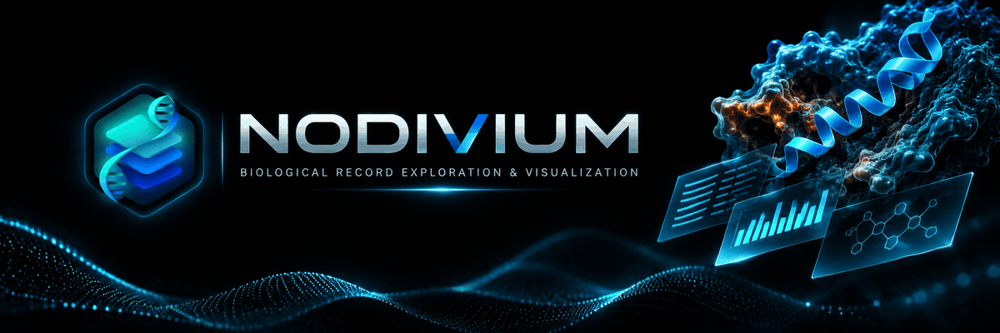
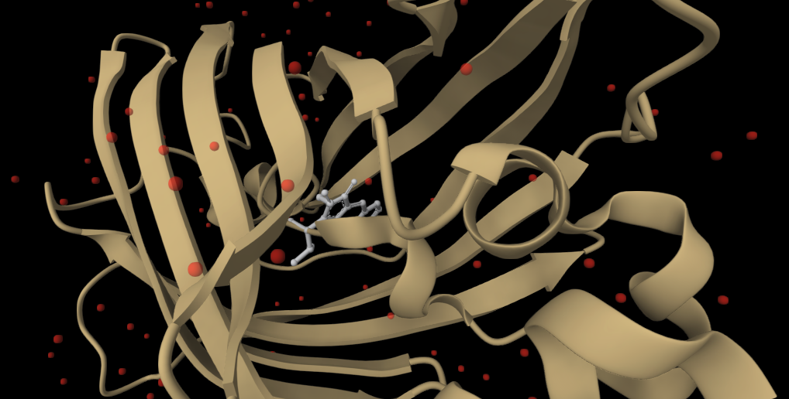
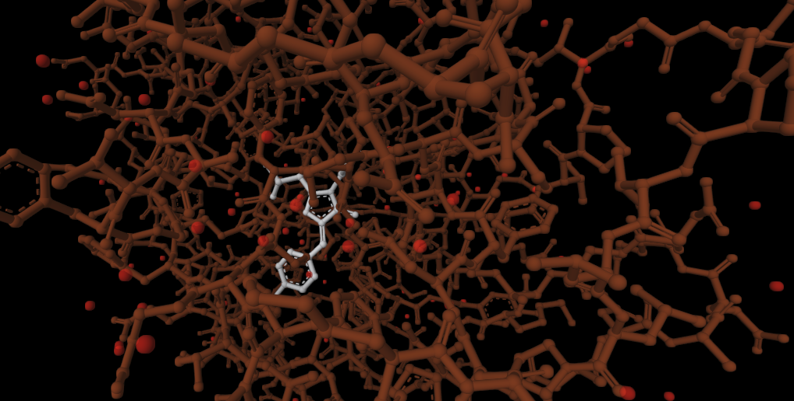
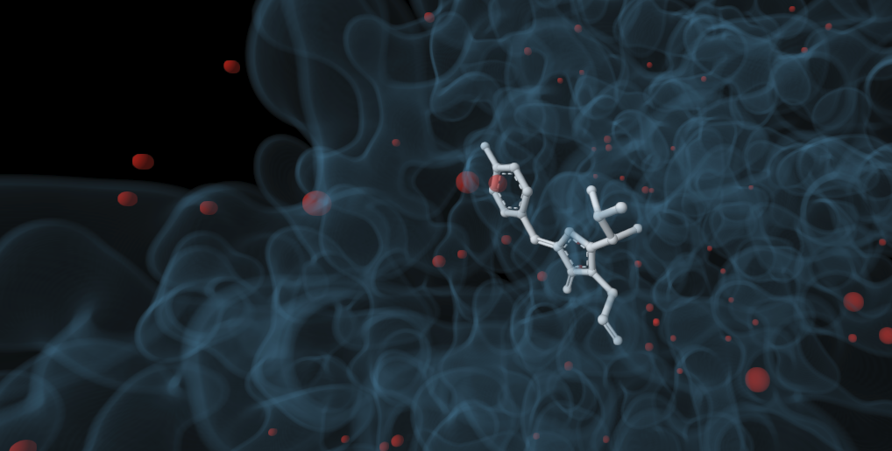
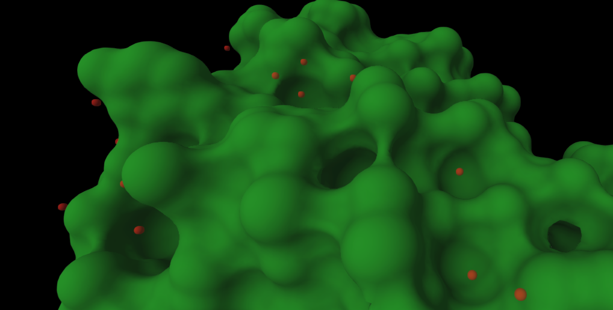
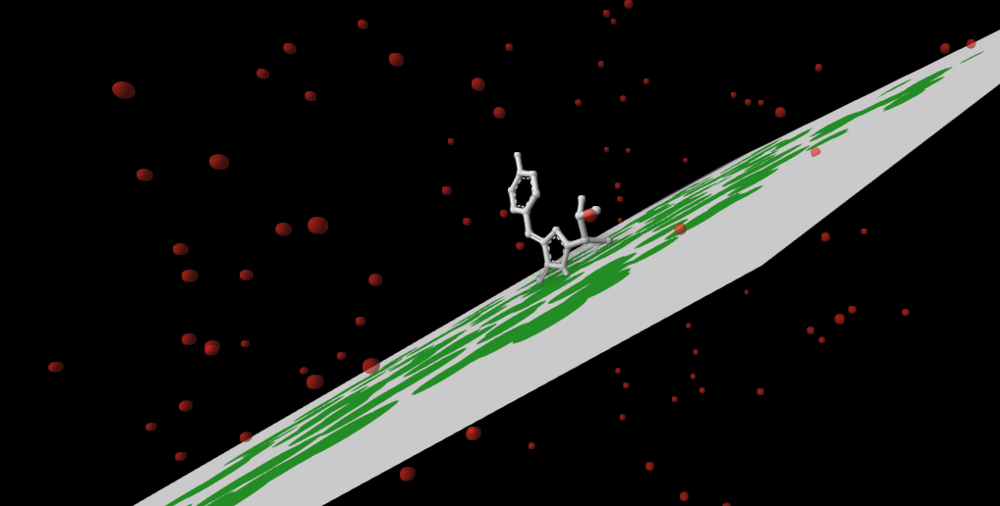
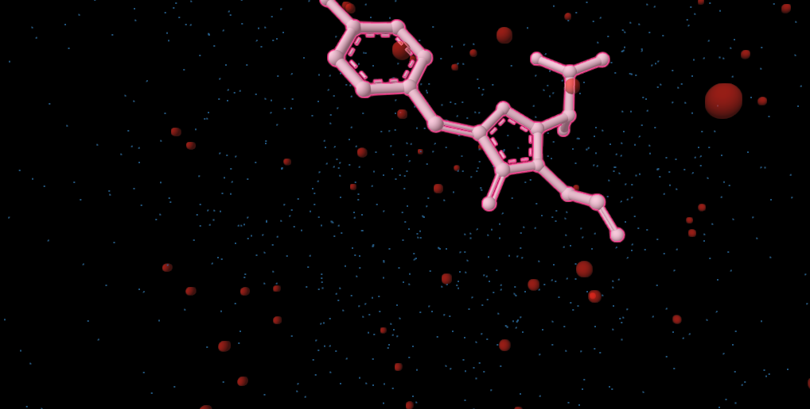

<div align="center">
  
</div>
<p align="center">
  
</p>


<div align="center">
<h3>A Unified Workspace for Biological Records</h3>

**Nodivium** brings records from **NCBI**, **UniProtKB** and **RCSB PDB** into one workspace. Search, read, visualize and export sequences, structures, genes and literature from a browser interface or a command line, instead of moving between three provider websites and a folder of loose downloads. Every export can carry a provenance manifest, so you can show where each file came from.

</div>


<div align="center">

[](https://pypi.org/project/nodivium/)
[](https://pypi.org/project/nodivium/)
[](https://github.com/Eswar-mse/Nodivium/actions)
[](LICENSE)
[](https://doi.org/10.5281/zenodo.24271314)

[](docs/USER_GUIDE.md#1-choose-an-install)
[](docs/USER_GUIDE.md#1-choose-an-install)
[](docs/USER_GUIDE.md#1-choose-an-install)
[](#privacy-and-data)

<div align="center">
<h3> Built with</h3>

[](https://www.python.org/)
[](https://biopython.org/)
[](https://requests.readthedocs.io/)
[](https://grantjenks.com/docs/diskcache/)
[](https://typer.tiangolo.com/)
[](https://github.com/Textualize/rich)
[](https://fastapi.tiangolo.com/)
[](https://www.uvicorn.org/)
[](https://molstar.org/)
[](https://get.webgl.org/)
[](https://nodejs.org/)
[](https://www.npmjs.com/)
[](https://developer.mozilla.org/docs/Web/HTML)
[](https://developer.mozilla.org/docs/Web/CSS)
[](https://developer.mozilla.org/docs/Web/JavaScript)
[](https://docs.pytest.org/)
[](https://github.com/Eswar-mse/Nodivium/actions)
[](https://pypi.org/project/nodivium/)
[](https://doi.org/10.5281/zenodo.24271314)

</div>

[](https://pypi.org/project/nodivium/)
[](docs/USER_GUIDE.md)
[](CHANGELOG.md)
[](https://github.com/Eswar-mse/Nodivium/issues)

</div>

<div align="center">
<h3>Core Capabilities</h3>

**Unified Search:** Search UniProtKB, NCBI (Nucleotide, Protein, Gene, PubMed) and RCSB PDB from one place. Open any record directly by accession.

**Source-Aware Records:** Read each record under Overview, Annotations, Linked records and Raw data. Links appear only when the source reports them, and missing data is shown as missing.

**Visual Inspector:** Examine sequence composition, GC content, features and residue ranges, and explore PDB structures in an interactive 3D viewer.

**Inspect Your Own Files:** Open FASTA, PDB and mmCIF files from your machine without uploading them anywhere.

**Collections and Provenance:** Gather up to 25 records, choose a format for each, and download one ZIP with a `manifest.json` that lists source, ID, format, status, size and SHA-256 checksum.

**Scriptable CLI:** Search, inspect, fetch and batch-download records from the terminal, with a 7-day disk cache for repeat access.

</div>


<div align="center">
<h3> A Visual Preview </h3>
A look at the Nodivium workspace. It supports both dark and light themes

<!-- DEMO GIF: a 15-25 s screen recording of the real web workspace. Search a term (e.g. "hemoglobin" in UniProtKB), open P68871, switch to PDB 1HHO and rotate the Mol* view, click Collect on two records, then Download ZIP. Save as assets/demo.gif -->

</div>


<div align="center">
<h3> Installation </h3>
</div>

> **Requirements:** Python 3.10 or newer and an internet connection. The PyPI package includes the web workspace and the CLI with prebuilt browser assets, so Node.js is not needed. Available on Windows, Linux and macOS.

**Recommended: install as an app with [uv](https://docs.astral.sh/uv/)**

```bash
uv tool install nodivium
nodivium version
```

**Or with pipx**

```bash
pipx install nodivium
```

**Or in a virtual environment**

```bash
# Linux / macOS
python3 -m venv .venv
source .venv/bin/activate
pip install nodivium
```

```powershell
# Windows PowerShell
py -m venv .venv
.\.venv\Scripts\Activate.ps1
pip install nodivium
```

Use one installer per command name, not both uv and pipx. If your system Python is externally managed, use uv, pipx or a virtual environment. Details, updates and source installs are in the [user guide](docs/USER_GUIDE.md#1-choose-an-install).


<div align="center">
<h3> Quick Start </h3>
</div>

NCBI requires a contact email. Set it in the same terminal before you start (an API key is optional):

```bash
# Linux / macOS
export NODIVIUM_NCBI_EMAIL='you@example.org'
export NODIVIUM_NCBI_API_KEY='optional-key'
```

```powershell
# Windows PowerShell
$env:NODIVIUM_NCBI_EMAIL='you@example.org'
$env:NODIVIUM_NCBI_API_KEY='optional-key'
```

Then start the workspace:

```bash
nodivium web
```

It serves at `http://127.0.0.1:8765` and opens your browser. Press **Ctrl+C** to stop. Use `--port 8766` if the port is busy, or `--no-browser` over SSH. Always open the `http://127.0.0.1` address, not a local HTML file.

Try these IDs first: UniProt `P68871`, PDB `1HHO`, NCBI nucleotide `NM_007294`. Full setup notes are in the [user guide](docs/USER_GUIDE.md#2-start-the-web-workspace).


<div align="center">
<h3>Explore & Inspect </h3>
</div>

<h3> Discover Records</h3>

Choose UniProtKB, NCBI or RCSB PDB, then search for up to 50 ranked results or open a record by accession ID. Filter UniProt to reviewed entries only, or jump straight to the source provider page.
<div>&nbsp;</div>

<!-- SCREENSHOT assets/discover.png: three-pane workspace. Left Discover panel with a source selector (UniProtKB) and search results for "hemoglobin" with the "Reviewed UniProt entries only" switch on; the centre pane showing the selected record. Dark theme, full window. -->
<div style="display: flex; gap: 4%; justify-content: space-between; width: 100%;">
  
  
</div>


**Includes**: UniProtKB · NCBI Nucleotide, Protein, Gene and PubMed · RCSB PDB · Open by ID · Reviewed-only filter · View source

[Read more in the user guide](docs/USER_GUIDE.md#3-explore-records-in-the-browser)
<div>&nbsp;</div>

<h3> Visual Inspector: Sequences</h3>

Inspect nucleotide and protein records through composition, GC content, windows, features and selected ranges. Ambiguous bases are counted separately, and NCBI Gene records show source-provided genomic locations.
<div>&nbsp;</div>

<!-- SCREENSHOT assets/inspector-sequence.png: right-hand Visual inspector for an NCBI nucleotide record such as NM_007294, showing base composition, the GC content plot and a highlighted feature or range. -->


**Includes**: Base and amino-acid composition · GC content · Sliding windows · Feature highlighting · Gene coordinates · PubMed abstracts

[Read more in the user guide](docs/USER_GUIDE.md#sequence-and-literature-views)
<div>&nbsp;</div>

<h3> Visual Inspector: 3D Structures</h3>

Open any PDB entry, or your own PDB or mmCIF file, in an interactive Mol* viewer. Recolor the scene, toggle protein, ligands, ions and water, switch representations, and select, label and measure residues.
<div>&nbsp;</div>

<!-- SCREENSHOT assets/structure.png: Mol* viewer with PDB 1HHO, showing the control panel (colors, Show components, Representations) beside the structure, with two residues selected and a distance measurement visible. -->
<div style="display: flex; flex-direction: column; gap: 16px; width: 100%;">
  <!-- Row 1 -->
  <div style="display: flex; gap: 4%; justify-content: space-between;">
    
    
  </div>
  
  <!-- Row 2 -->
  <div style="display: flex; gap: 4%; justify-content: space-between;">
    
    
  </div>
  
  <!-- Row 3 -->
  <div style="display: flex; gap: 4%; justify-content: space-between;">
    
    
  </div>
</div>


**Includes**: Rotate and zoom · Fit structure · Component toggles · Representation styles · Select residues · Label selection · Measure distance · Hide or isolate selection · Light and dark themes

[Read more in the user guide](docs/USER_GUIDE.md#pdb-structure-view)
<div>&nbsp;</div>


<div align="center">
<h3> Command Line </h3>
</div>

Everything that matters is scriptable. Run `nodivium` for the command guide, or `nodivium COMMAND --help` for options.

```bash
nodivium search hemoglobin --source uniprot --reviewed --limit 5
nodivium info P68871 --source uniprot
nodivium fetch 1HHO --source pdb --format cif --output 1HHO.cif
nodivium batch P68871 P69905 --source uniprot --format fasta --outdir records
nodivium cache stats
```

| Command | Purpose |
|---|---|
| `nodivium web` | Start the browser workspace (`--port`, `--no-browser`) |
| `nodivium search TERM` | Search a source (`--source`, `--db`, `--reviewed`, `--limit`) |
| `nodivium info ID --source SRC` | Show record metadata |
| `nodivium fetch ID --source SRC` | Preview or save one record (`--format`, `--output`, `--no-cache`) |
| `nodivium batch ID ... --source SRC` | Save several records, one file each (`--outdir`, `--format`) |
| `nodivium cache stats / list / delete / clear` | Inspect and manage the local cache |
| `nodivium version` | Print the installed version |

[Full CLI reference](docs/USER_GUIDE.md#7-use-the-cli)


<div align="center">
<h3> Sources & Formats </h3>

[](docs/USER_GUIDE.md#8-supported-sources-and-formats)
[](docs/USER_GUIDE.md#8-supported-sources-and-formats)
[](docs/USER_GUIDE.md#8-supported-sources-and-formats)
[](docs/USER_GUIDE.md#8-supported-sources-and-formats)
[](docs/USER_GUIDE.md#8-supported-sources-and-formats)
[](docs/USER_GUIDE.md#8-supported-sources-and-formats)


| Source / record type | Formats | Default |
|---|---|---|
| NCBI Nucleotide | `fasta` · `genbank` · `xml` | `fasta` |
| NCBI Protein | `fasta` · `genpept` · `xml` | `fasta` |
| NCBI Gene | `xml` · `gene_table` | `xml` |
| NCBI PubMed | `xml` · `medline` · `abstract` | `xml` |
| UniProtKB | `fasta` · `json` · `txt` · `xml` · `tsv` | `fasta` |
| RCSB PDB | `cif` · `pdb` · `fasta` | `cif` |

</div>

Search terms are 2 to 250 characters. Direct IDs can be up to 80 characters. See [supported sources and formats](docs/USER_GUIDE.md#8-supported-sources-and-formats) for the details.


<a id="privacy-and-data"></a>
<div align="center">
<h3> Privacy and Data </h3>
</div>

- The web service listens only on `127.0.0.1`. Remote requests go from your machine to NCBI, UniProt or RCSB PDB.
- Local files stay in the browser session. They are not uploaded and not written to the cache.
- Remote content is cached for **7 days** on disk, at `~/.cache/nodivium/` on Linux and macOS and under `%LOCALAPPDATA%\nodivium\` on Windows. `nodivium cache stats` shows the exact path.
- The browser stores your theme, viewer preferences and collection list in local storage. Clearing site data removes them.
- Check each provider's usage terms before distributing downloaded content. Nodivium is an independent project and is not affiliated with NCBI, UniProt or RCSB PDB.

[Cache, settings and privacy in the user guide](docs/USER_GUIDE.md#9-cache-settings-and-privacy)


<div align="center">
<h3> Project Status </h3>
</div>

Tests run in CI against mocked provider requests. Release scope and required checks are in [`docs/RELEASE.md`](docs/RELEASE.md), the clean-install acceptance checks for Windows and Linux are in [`docs/TEST_RUNBOOK.md`](docs/TEST_RUNBOOK.md), and remaining web work is tracked in [`docs/WEB_UPGRADE.md`](docs/WEB_UPGRADE.md). Release notes live in the [changelog](CHANGELOG.md).


<div align="center">

<h3>Documentation</h3>

Everything beyond this page lives in one place: **[docs/USER_GUIDE.md](docs/USER_GUIDE.md)**

[](docs/USER_GUIDE.md#1-choose-an-install)
[](docs/USER_GUIDE.md#2-start-the-web-workspace)
[](docs/USER_GUIDE.md#3-explore-records-in-the-browser)
[](docs/USER_GUIDE.md#4-use-the-visual-inspector)
[](docs/USER_GUIDE.md#5-inspect-your-own-files)
[](docs/USER_GUIDE.md#6-download-records-and-collections)
[](docs/USER_GUIDE.md#7-use-the-cli)
[](docs/USER_GUIDE.md#8-supported-sources-and-formats)
[](docs/USER_GUIDE.md#9-cache-settings-and-privacy)
[](docs/USER_GUIDE.md#10-troubleshooting)
[](docs/USER_GUIDE.md#11-report-an-issue)

[](https://pypi.org/project/nodivium/)
[](https://github.com/Eswar-mse/Nodivium/issues)
[](CHANGELOG.md)

When reporting a bug, include the Nodivium version (`nodivium version`), OS, Python version, install method, browser version for visual issues, the exact command or steps, the source and ID, and the full error text. Please remove API keys, private file contents and personal emails from anything you post.

</div>


<div align="center">
<h3>License</h3>

Nodivium is released under the **MIT License**. See [`LICENSE`](LICENSE). Third-party libraries keep their own licenses, and records you download remain subject to the terms of the provider they came from.
</div>


<div align="center">
<h3> Cite</h3>

If Nodivium helps your work, please cite it. GitHub's **Cite this repository** button (from [`CITATION.cff`](CITATION.cff)) gives BibTeX and APA.

[](https://doi.org/10.5281/zenodo.24271314)
</div>

```bibtex
@software{moparti_nodivium,
  author = {Moparti, Sri Venkata Satya Sai Eswar},
  title  = {{Nodivium}: biological record exploration and visualization for NCBI, UniProt and RCSB PDB},
  year   = {2026},
  doi    = {10.5281/zenodo.24271314},
  url    = {https://github.com/Eswar-mse/Nodivium}
}
```

Please also cite the resources you retrieve records from, notably [NCBI](https://www.ncbi.nlm.nih.gov/home/about/policies/), [UniProt](https://www.uniprot.org/help/publications) and [RCSB PDB](https://www.rcsb.org/pages/policies), and [Mol\*](https://molstar.org/) for the 3D viewer.


<div align="center">
<h3>Author and contact</h3>
</div>

**Sri Venkata Satya Sai Eswar Moparti**

[ORCID](https://orcid.org/0009-0005-4635-7368) · [Google Scholar](https://scholar.google.com/citations?user=Bzc45zwAAAAJ&hl=en) · [msaieswar2002@gmail.com](mailto:msaieswar2002@gmail.com)

&copy; Sri Venkata Satya Sai Eswar Moparti. Released under the MIT License.
